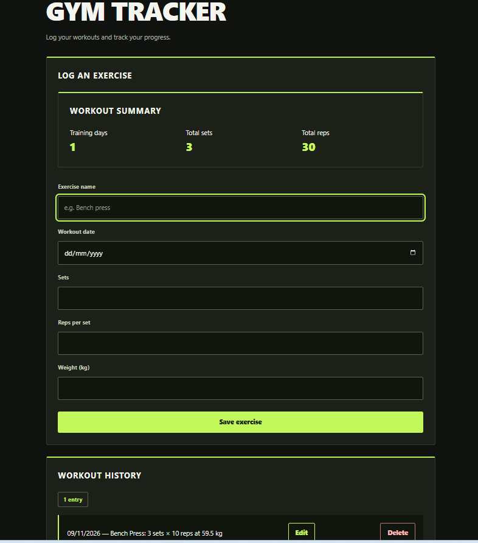

# Gym Tracker

A browser-based workout log built with HTML, CSS, and JavaScript. Log your lifts, review your workout history, and see how many days, sets, and reps you’ve logged.

## Live demo

[Open Gym Tracker](https://imjustanees.github.io/gym-tracker/)

## Screenshot



## Features

- Log an exercise with its date, sets, reps per set, and weight in kilograms.
- Edit or delete an exercise from your workout history.
- See total training days, sets, and reps update as you change your log.
- Keep your entries after refreshing the page using browser storage.

## How the summary works

Training days count each date once, even if you log several exercises that day. Total reps are calculated by multiplying sets by reps per set for each entry and adding the results together. For example, 3 sets of 10 and 2 sets of 8 on the same day count as 1 training day, 5 sets, and 46 reps.

## Run locally

Clone or download this repository. From the project folder, run:

```bash
python3 -m http.server 8000
```

Open [http://localhost:8000](http://localhost:8000) in your browser.

## Data storage

Entries are saved in the browser using `localStorage`. They stay in that browser on that device, and clearing the site’s browser data removes them.